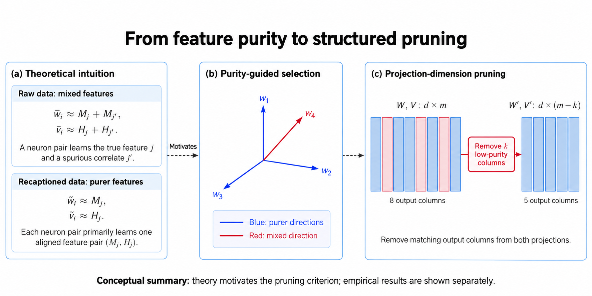
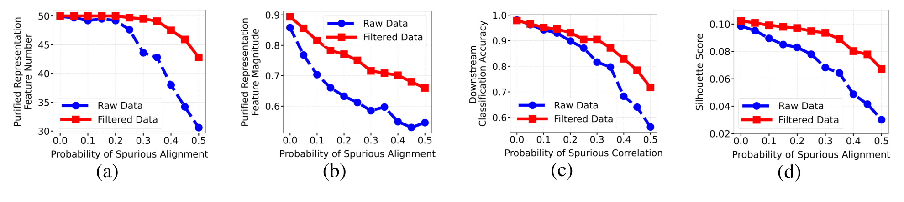
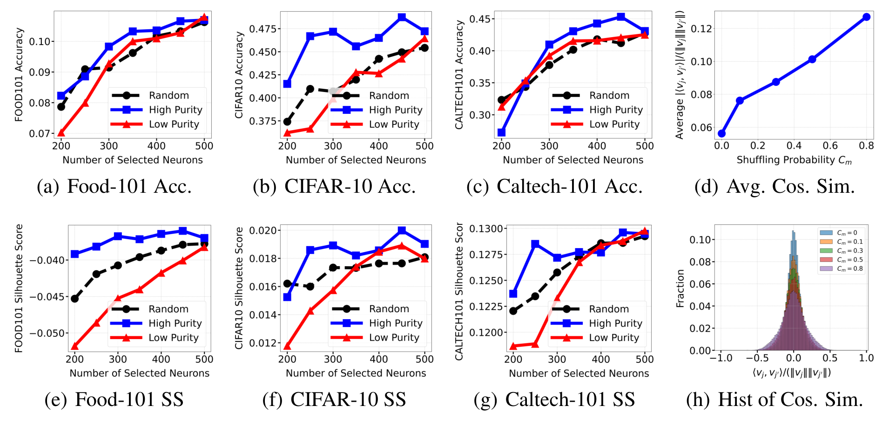

# Contrastive Learning with Data Misalignment
### Feature Purity, Training Dynamics and Theoretical Generalization Guarantees

**NeurIPS 2025** · Jiawei Sun, Shuai Zhang, Hongkang Li, Meng Wang

[Paper](https://openreview.net/forum?id=JMlYzOMDxI) · [Project page](https://sun-messi.github.io/projects/data-misalignment/) · [Jiawei Sun](https://sun-messi.github.io/)



*Conceptual overview from the project page, adapted from the presentation. This is an illustration, not experimental data. The LLaVA follow-up uses a different post-GELU masking intervention.*

## What does misalignment change?

A caption can omit an image feature or introduce an unrelated feature. Our analysis connects such misalignment to mixed neuron representations, and studies how recaptioning and filtering can improve feature purity and generalization. The guarantees concern the paper's structured data model and jointly trained shallow nonlinear encoders; they are not universal guarantees for arbitrary VLMs.

This repository contains practical CLIP/LaCLIP evaluation, matched projection-column selection, caption perturbation and projection-only fine-tuning scripts. It is not a complete reproduction package for every theorem or experiment.

## Paper results



*Original paper Figure 1: raw versus filtered data, feature purity and out-of-domain generalization.*



*Original paper Figure 2: neuron selection and controlled caption misalignment. These replace the older individual plots previously featured here; no new experimental results are claimed.*

## Installation

Run commands from the repository root; the Python modules are at the root, not in a `src/` directory.

```bash
python -m venv .venv
source .venv/bin/activate
python -m pip install -r requirements.txt
```

Install a PyTorch/torchvision build compatible with your CUDA environment. The requirements include **OpenAI CLIP**, not the unrelated PyPI package named `clip`. The tokenizer uses a local BPE vocabulary if present, otherwise the vocabulary bundled with OpenAI CLIP. Installing dependencies may require network access.

The legacy dependency range is not a tested lockfile. CPU unit tests below do not establish CUDA or full training reproducibility.

## Checkpoints and data

Obtain trusted CLIP/LaCLIP checkpoints from [LaCLIP](https://github.com/LijieeFan/LaCLIP); the scripts expect a `state_dict` checkpoint compatible with `models.CLIP_VITB16`. Only load checkpoints you trust.

Evaluation downloads torchvision datasets into `./data`. Some datasets require additional manual preparation or permission. For training, prepare image files plus the image/caption CSV consumed by `data.py`, and ImageNet validation data. See [reproduction notes](docs/REPRODUCTION.md) before launching a long run.

### Compare CLIP and LaCLIP

```bash
python batch_eval.py \
  --checkpoints CLIP:checkpoints/cc3m_clip.pt LaCLIP:checkpoints/cc3m_laclip.pt \
  --datasets CIFAR10 FOOD101 --output-dir results/comparison
```

Outputs accuracy (fraction, not percent) and cosine-distance silhouette scores. Full-dataset silhouette computation can be expensive. Dataset splits and preprocessing are part of the protocol; do not compare changed settings to paper numbers as if identical.

### Select matched projection dimensions

```bash
python run_eval_sam_sweep.py \
  --checkpoint checkpoints/cc3m_laclip.pt --device cuda:0 \
  --datasets CIFAR10 FOOD101 --sam-values 200 300 400 500 \
  --output-dir results/pruning
```

The script retains matching dimensions of image/text embeddings and compares full, minimum-similarity and maximum-similarity subsets. Minimum similarity is a proxy for greater feature purity. This script does **not** implement the paper's random-selection comparison; do not label its output as that baseline. This is feature selection during evaluation, not a measured sparse-kernel speedup.

### Analyze projection geometry

```bash
python analyze_purity.py \
  --checkpoints Cs0:checkpoints/base.pt Cs30:checkpoints/shuffled.pt \
  --projection both --output-csv results/purity.csv \
  --output-plot results/purity.png --output-hist results/histograms.png
```

Labels such as `Cs30` are parsed as 0.30 for plotting; they are labels, not evidence of the checkpoint's training settings. Lower average absolute cosine similarity means more orthogonal directions. The legacy statistic zeros the diagonal and averages over all m² entries; it differs by (m−1)/m from an off-diagonal-only mean. That convention is retained for comparability.

## Repository map

| Entry | Purpose |
| --- | --- |
| `models.py`, `losses.py`, `data.py`, `tokenizer.py`, `utils.py` | CLIP model, loss, loading and utilities |
| `train.py` | Projection-only fine-tuning |
| `batch_eval.py` | Checkpoint comparison |
| `run_eval_sam_sweep.py` | Matched dimension-selection sweep |
| `analyze_purity.py` | Projection similarity metrics and plots |
| `generate_misaligned_text.py` | Legacy similarity-based caption perturbation |
| `docs/` | Current reproduction notes and figure provenance |
| `tests/` | Small CPU regression tests |

Older nested `mnt/` documents and the bundled archive are historical artifacts, not the current runnable layout. They are preserved rather than silently deleted.

## From CLIP to LLaVA

The [project page](https://sun-messi.github.io/projects/data-misalignment/#llava) includes the FCRC 2026 follow-up on LLaVA projector pruning. It is separate from the NeurIPS 2025 results. This repository does not currently provide an end-to-end LLaVA reproduction pipeline.

## Validation

```bash
python -m unittest discover -s tests -v
python -m compileall -q .
```

See [reproduction notes](docs/REPRODUCTION.md) for tested scope and remaining limitations.

## Citation

```bibtex
@inproceedings{sun2025contrastive,
  title={Contrastive Learning with Data Misalignment: Feature Purity, Training Dynamics and Theoretical Generalization Guarantees},
  author={Sun, Jiawei and Zhang, Shuai and Li, Hongkang and Wang, Meng},
  booktitle={Advances in Neural Information Processing Systems},
  year={2025},
  url={https://openreview.net/forum?id=JMlYzOMDxI}
}
```

Built on [LaCLIP](https://github.com/LijieeFan/LaCLIP) and CLIP. Code licensing follows [LICENSE](LICENSE); cited paper figures retain their original attribution.
